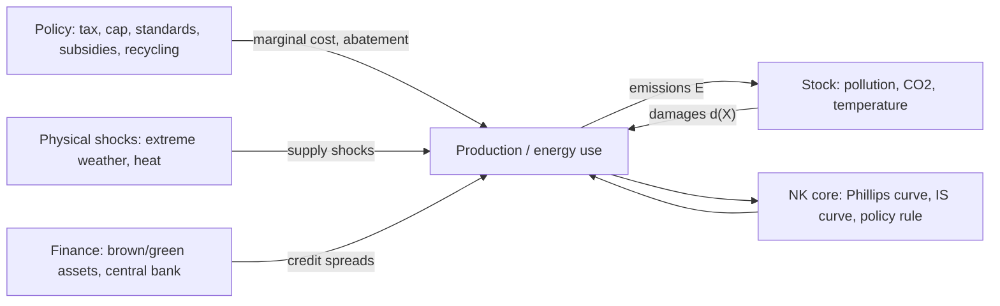

# Module 11: Environmental New Keynesian models (E-DSGE)

> **Goal:** understand the ways the environment enters an NK model, know the literature map, understand the canonical E-NK model line by line (it is coded
> in `code/enk.py` and `dynare/etank.mod`), and read its results the way a referee would.

## 11.1 How the environment enters an NK model (it is not only taxes)

An environmental NK model is the NK core plus **four blocks**. Each block has several modeling options, and the
choice of options *is* the paper's identity.

| Block | Options | Classic references |
|---|---|---|
| **1. Source of emissions** | by-product of output $E = \varphi(1-U)Y$ (this repo); fossil **energy input** in production ($E \propto$ fossil use); household energy consumption; brown vs. green sectors | Heutel (2012); Fischer–Springborn (2011); Golosov et al. (2014) |
| **2. Stock dynamics** | pollution stock with decay; carbon cycle + temperature (DICE-style) | Heutel (2012); Nordhaus; Golosov et al. (2014) |
| **3. Damages (the externality)** | on TFP $Y=(1-d(X))AF$ (most common); in utility (pollution disutility); on capital depreciation; on labor productivity/health; on volatility (disaster risk) | Heutel; GHKT; Hassler–Krusell–Smith (2016) |
| **4. Mitigation and policy** | abatement technology; clean/dirty substitution, directed technical change; instruments: **tax, cap-and-trade, intensity target, standards, green subsidies, green public investment, revenue recycling, border adjustment**; central-bank/financial tools: green QE, collateral, capital requirements | Annicchiarico–Di Dio (2015); Acemoglu et al. (2012); Module 5 papers |

Blocks 1–3 make it *environmental*: a closed loop with an externality. Without them you have an **energy** NK model
(energy price shocks), which is also a legitimate and closely related literature.

### Physical risk vs. transition risk (NGFS taxonomy)

* **Transition risk:** macro effects of *moving away* from fossil fuels: carbon prices, regulation, technology shifts, stranded assets.
* **Physical risk:** macro effects of *climate itself*, both **acute** (floods, droughts, heat waves → supply shocks, capital
  destruction, food-price spikes) and **chronic** (lower productivity, lower potential growth, a possibly lower natural rate $r^*$).

Isabel Schnabel's (ECB, 2022) split of the inflation consequences is a useful map:
**climateflation** (physical risk, e.g. weather-driven food prices), **fossilflation** (fossil energy prices),
**greenflation** (transition demand for metals and minerals, and carbon pricing).

### Why business-cycle NK work has focused on the transition side

1. **Damages are slow.** The pollution stock barely moves at quarterly frequency (see §11.3–11.4: with a 10% domestic share and
   0.21% quarterly decay, $X$ is almost constant). Over a 2–3-year monetary-policy horizon, damages through the stock are
   second order.
2. **Policy is fast and large.** Carbon prices can jump (EU ETS has ranged from ~5 to ~100 €/t) and enter marginal cost immediately.
3. **A pure physical TFP shock creates no policy trade-off in the basic NK model.** It moves natural and efficient output together,
   so divine coincidence holds. Physical shocks matter for monetary policy only with extra structure:
   * hitting **specific sectors** (food, energy) with different price stickiness (Module 8);
   * **real-wage rigidity** (Blanchard–Galí);
   * persistent effects on **$r^*$** and hence on how often the ZLB binds (Module 4);
   * **capital destruction** with financial frictions (Module 5);
   * **disaster risk** affecting precautionary saving (nonlinear solution needed).

   That is why physical risk is a growing but less mature area for NK modeling, and potentially a good niche.
   Relevant starting points include Keen & Pakko (2011, *Southern Economic Journal*), "Monetary policy and natural disasters in a DSGE model",
   and the empirical work on temperature shocks and inflation (e.g. Kotz, Kuik, Lis & Nickel 2024, *Communications Earth & Environment*).

### So what are E-NK papers actually about? Three families of questions

| Family | Object of study | Example question | Example papers |
|---|---|---|---|
| **A. Environmental policy design over the cycle** | the environmental instrument | Tax or cap when prices are sticky? Should the carbon price be procyclical? | Heutel (2012); Fischer–Springborn (2011); Annicchiarico–Di Dio (2015) |
| **B. Climate and macro stabilization** | monetary (and fiscal) policy | Is the transition inflationary? How should the central bank react to carbon taxes or climate shocks? | Nakov–Thomas; Del Negro et al.; Olovsson–Vestin; Ferrari–Nispi Landi (2022) |
| **C. Climate and finance** | financial stability, central-bank balance sheet | Does transition risk amplify through banks? Does green QE work? | Carattini et al. (2023); Diluiso et al. (2021); Ferrari–Nispi Landi (2023) |

Across all three, the **transmission channels** of the environmental block into the NK core are:

1. **Cost channel:** taxes, abatement and energy prices raise marginal cost → Phillips curve (cost-push). *The dominant channel.*
2. **Demand channel:** revenue recycling, income and wealth effects (HANK), green investment booms.
3. **Financial channel:** asset revaluation (stranded assets), net worth, spreads.
4. **Supply / natural-rate channel:** damages and physical shocks lower potential output and possibly $r^*$.
5. **Expectations channel:** announced carbon-price paths, salience of energy prices, credibility.

So transition risk is the most-studied piece, but it is only one row of one table: a paper can be about
policy *design* (family A), about the *cost channel* without any "risk" at all, or about physical risk.

## 11.2 Literature map

**Foundations (RBC + environment)**
* Fischer & Springborn (2011, *JEEM*), "Emissions targets and the real business cycle: intensity targets versus caps or taxes".
* Heutel (2012, *RED*), "How should environmental policy respond to business cycles?". Emissions are procyclical (elasticity < 1);
  the optimal policy lets emissions be procyclical, but less than a fixed tax would.
* Angelopoulos, Economides & Philippopoulos (2013), optimal environmental policy under uncertainty.
* Survey you should read first: **Annicchiarico, Carattini, Fischer & Heutel (2022), "Business cycles and environmental policy: a primer",
  *Environmental and Energy Policy and the Economy* 3.**
* Long-run climate macro: Golosov, Hassler, Krusell & Tsyvinski (2014, *Econometrica*); Hassler, Krusell & Smith (2016, *Handbook of Macro*);
  Acemoglu, Aghion, Bursztyn & Hemous (2012, *AER*) on directed technical change; Nordhaus's DICE.

**New Keynesian E-DSGE**
* **Annicchiarico & Di Dio (2015, *JEEM*), "Environmental policy and macroeconomic dynamics in a New Keynesian model"**: tax vs. cap vs.
  intensity target under nominal rigidities; Ramsey policy. *The paper closest to `code/enk.py`.*
* Annicchiarico & Di Dio (2017, *Environmental and Resource Economics*), "GHG emissions control and monetary policy".
* Economides & Xepapadeas (2018, CESifo/Bank of Greece WP), "Monetary policy under climate change".
* Nakov & Thomas (2026, *JPE Macro*), "Climate-conscious monetary policy" (Module 3).
* Del Negro, di Giovanni & Dogra (FRBNY SR 1053), "Is the green transition inflationary?" (Module 8).
* Olovsson & Vestin (2023, Riksbank WP), "Greenflation?".
* Ferrari & Nispi Landi (2022, ECB WP 2726), expectations and the green transition (Module 9).
* Coenen, Lozej & Priftis (2024, *European Economic Review*): carbon transition in the ECB's NAWM with a disaggregated energy sector,
  an example of a policy-institution-scale model.

**Frontier combinations** (Modules 5–9): financial frictions (Carattini, Heutel & Melkadze 2023; Diluiso et al. 2021; Ferrari &
Nispi Landi 2023), open economy (Annicchiarico & Diluiso 2019; Airaudo, Pappa & Seoane), heterogeneity (Känzig 2023; Gas-TANK;
HANK with energy), price setting (Del Negro et al.).

> **Caveat on references:** listed from memory and spot-checked. Before citing, confirm each one's final journal/year
> on Google Scholar/RePEc. Working papers in this field get published fast.

## 11.3 The canonical E-NK model (as coded)

Everything from Module 1, plus:

**Emissions and abatement.** Firm $j$ emits $E_t(j) = \varphi(1-U_t(j))Y_t(j)$ and pays an abatement cost
$\theta_1 U_t(j)^{\theta_2} Y_t(j)$ (DICE form) plus a tax $\tau_t$ per unit of emissions. Cost minimization per unit of output:

$$
\min_U\; \theta_1 U^{\theta_2} + \tau_t\varphi(1-U) \;\Rightarrow\; \theta_1\theta_2 U_t^{\theta_2-1} = \tau_t\varphi .
$$

**Real marginal cost now has an environmental component:**

$$
MC_t = \underbrace{\frac{W_t/P_t}{A_t(1-d(X_t))}}_{\text{labor}} + \underbrace{\theta_1 U_t^{\theta_2}}_{\text{abatement}} + \underbrace{\tau_t\varphi(1-U_t)}_{\text{carbon tax bill}} .
$$

So a carbon-tax increase raises marginal cost and enters the NKPC like a **cost-push** shock, unless it also moves
natural/efficient output by the same amount (Module 3, §3.4).

**Pollution and damages.** $X_t = (1-\delta_X)X_{t-1} + E_t + E^{row}$ and output loss $d(X_t) = 1 - e^{-\gamma_d X_t}$ (Heutel uses a quadratic).
With a domestic share of world emissions of 10% and quarterly decay of 0.21%, $X$ barely moves at business-cycle
frequencies: **damages are a long-run issue; business-cycle E-DSGE is mostly about the cost side.**

**Policy regimes.** *Tax*: $\tau_t = \bar\tau e^{z_t}$. *Cap*: $E_t = \bar E e^{z_t}$, so $\tau_t$ is the endogenous permit price.
**Revenue** $\tau_tE_t$ is rebated lump-sum: uniformly, to HtM only, or to savers only.
**Households**: a share $\lambda$ of HtM (Module 7). **Monetary policy**: Taylor rule.

Calibration (in `BASE` in `code/enk.py`): quarterly, $\beta = 0.99$, $\sigma=\varphi=1$, $\varepsilon = 6$, $\theta = 0.75$,
$\theta_1 = 0.056$, $\theta_2 = 2.8$, steady-state abatement 20%, $\delta_X = 0.0021$, steady-state damages 0.5% of output.

## 11.4 Results (run `python code/enk.py`)

**(a) TFP shock, tax vs. cap** (`figures/enk_tfp_tax_vs_cap.png`)
* Under a **tax**, emissions rise one-for-one with output (procyclical, as in the data).
* Under a **cap**, emissions are fixed, so the **permit price absorbs the shock**: +6% for a 1% TFP shock. In a boom firms
  pay more for permits, and that dampens the boom: the cap is an automatic stabilizer for output but transmits volatility to
  carbon prices. Hours fall more under the cap.
* Volatility (simulated, σ_a = 0.7%): output 2.08% (tax) vs 2.03% (cap); emissions 2.08% vs 0; carbon price 0 vs 14.6%.
  This qualitatively matches Fischer & Springborn and Annicchiarico & Di Dio.

**(b) Carbon tax +10%, RANK vs. TANK and recycling** (`figures/enk_tax_shock_tank.png`)
* Output falls, inflation **rises**, and the central bank raises rates: a cost-push shock. Emissions fall ~1.4%.
* Aggregates barely depend on λ or the rebate (χ ≈ 1 in this baseline, see Module 7). **Distribution** depends a lot on the rebate:
  rebating to HtM makes their consumption rise while savers bear the cost; rebating to savers nearly doubles the HtM loss.
* The rebate to HtM raises aggregate demand a bit, so inflation and rates rise more: recycling design interacts with monetary policy.

**(c) Same shock, different monetary rules** (`figures/enk_tax_shock_monpol.png`)
* Hawkish rules cut the inflation response but deepen the output/HtM consumption loss: the standard cost-push trade-off.

**Magnitudes are small** because the carbon-tax bill is ~0.7% of output in this calibration. Real-world questions
(a path to 100+ €/t, energy as a separate input with low substitutability) need a richer energy block and nonlinear
transitions (Module 10).

## 11.5 What a "sophisticated" version adds (pick 1–2, not all)

1. A separate **energy** input (fossil vs. clean), CES with low short-run substitutability. This is where real inflation effects come from.
2. **Capital** with adjustment costs; green vs. brown capital (transition risk).
3. **Sticky wages** (who absorbs the cost?).
4. **Heterogeneity**: TANK/THANK (analytic) or HANK (quantitative), with non-homothetic energy demand.
5. **Open economy**: imported energy, CBAM, exchange rate.
6. **Financial frictions**: GK banks holding brown assets.
7. **Nonlinearities**: ZLB, state-dependent pricing.
8. **Expectations**: credibility of the announced carbon path.
